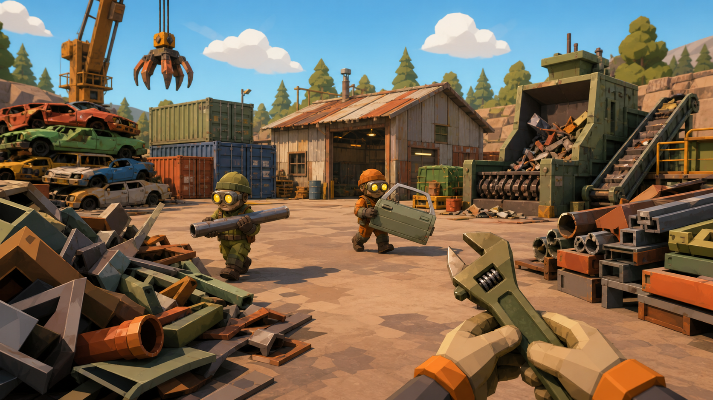

# ¡ESO TODAVÍA SIRVE! 🛠️

> El simulador de chatarrería donde todo tiene valor… hasta que tus amigos lo rompen.
> Simulación cooperativa / comedia física · 1–7 jugadores · primera persona · Windows PC

**Prototipo jugable v0.1 en el navegador** — validación del loop (*golpear → romper → recuperar → pesar → vender*)
y del objetivo de estilo visual (low-poly plano, paleta corta, emisivos, UI redonda con números gigantes,
en el lenguaje de *Moon Sweepers* / sims cooperativos modernos).



## ▶️ Jugar el prototipo

```bash
git clone https://github.com/joerojas2810-collab/eso-todavia-sirve
cd eso-todavia-sirve/prototype
python3 -m http.server 8080
# abrir http://localhost:8080
```

(Sirve por HTTP: usa ES modules. No necesita build ni dependencias: three.js r160 viene vendoreado en `prototype/vendor/`.)

| Tecla | Acción |
|---|---|
| WASD / Shift | moverse / correr |
| Mouse (clic para capturar) | mirar · fallback: clic derecho mantenido |
| Clic izq. | golpear con la llave · si tenés algo, lo lanza |
| F | agarrar / soltar / depositar en la balanza |
| R | vender todo lo que haya en la balanza |
| B | oficina de mejoras |
| Espacio | saltar |

## 📐 Principios de diseño (pitch)

1. **Una actividad sencilla satisfactoria por sí misma**: desarmar, romper, recuperar y vender.
2. **Progresión constante**: cada encargo consigue herramientas, máquinas, espacios y objetos nuevos.
3. **Caos cooperativo**: los jugadores trabajan juntos, pero sus decisiones producen situaciones inesperadas y cómicas.

## 🗂️ Contenido del repo

| Ruta | Qué es |
|---|---|
| `unity/` | **Proyecto Unity 6 definitivo** (base U6-First-Person-Multiplayer + código propio `_ETSV`). Guía de apertura: `unity/README.md` · estado de integración: `unity/docs/INTEGRACION.md` · atribuciones: `unity/ATTRIBUTION.md` |
| `prototype/` | Prototipo jugable web (three.js, sin build), **congelado como referencia ejecutable de las reglas**. v0.3: loop vender/romper + desmontaje modular + economía/inventario/almacenes. 73 tests de reglas (20 desmontaje + 53 economía) |
| `docs/DOc 1.txt`…`DOc 5.txt` | **Los cinco GDD: fuente de verdad del diseño** |
| `docs/GDD_catalogo.md` | Catálogo de objetos desmontables: reglas globales, objeto 01 completo y plantilla de los 30 |
| `docs/sistemas_recuperacion_economia.md` | Sistemas de recuperación, inventario, almacenamiento y economía (capas, contratos, registro PROVISORIO) |
| `docs/INFORME_auditoria_reutilizacion.md` | Auditoría Instrucción 03: qué reutilizar (bases Unity, packs de arte), licencias verificadas y matriz de decisión |
| `unity/docs/MATRIZ_PARIDAD_TESTS.md` | Instrucción 05: equivalencia de los 73 tests JS → NUnit y resultados de ejecución |
| `unity/docs/INTEGRACION_DESARMADO.md` | Instrucción 06: sistemas de U6-FPM reutilizados, arquitectura host-autoritativa, adaptaciones y checklist de editor |
| `unity/docs/INTEGRACION_ECONOMIA.md` | Instrucción 07: transporte ↔ dominio, balanza/trituradora/residuos/almacenes/contenedores (14 estaciones), economía compartida con trazabilidad, networking y checklist de editor |
| `INFORME_tecnico.md` | Investigación: reverse-engineering del estilo de Moon Sweepers, stack recomendado (Unity 6 + URP + NGO/Relay), bases de assets y código usables, plan de vertical slice |
| `refs/` | Moodboards objetivo de estilo (imagen generada como referencia de dirección de arte, no es arte final) |

## 🎯 Hoja de ruta

- [x] Investigación de estilo y stack (`INFORME_tecnico.md`)
- [x] Prototipo v0.1: loop romper→vender + mejoras + estilo visual
- [x] v0.2 (Instrucción 01): sistema de desmontaje modular + microondas jugable + tests de reglas
- [x] v0.3 (Instrucción 02): recuperación, inventario, almacenamiento y economía sobre los GDD 3.0/4.0/5.0
- [x] Instrucción 03: auditoría de reutilización (`docs/INFORME_auditoria_reutilizacion.md`)
- [x] **Instrucción 04: proyecto Unity 6 sobre la base U6-FPM (1–7 jugadores adaptado, Vivox desactivado, dominio puro `_ETSV`)**
- [x] **Instrucción 05: dominio migrado a C# puro (catálogo, desarmado, piezas, almacenes, economía, persistencia) + 73 tests JS portados a NUnit y ejecutados bajo Mono (33/33 PASS — ver `unity/docs/MATRIZ_PARIDAD_TESTS.md`)**
- [x] **Instrucción 06: desmontaje físico integrado a Unity (microondas por blueprint, host-autoritativo con NGO 2.12, herramientas, HUD, piezas PickupItem, late-join) + 13 verificaciones §10 (46/46 PASS bajo Mono — ver `unity/docs/INTEGRACION_DESARMADO.md`)**
- [x] **Instrucción 07: recuperación, almacenamiento y economía cooperativa integrados (transporte PickupItem ↔ dominio, balanza/trituradora/residuos especiales/almacenes/contenedores = 14 estaciones host-autoritativas, economía compartida "chatarrería" con trazabilidad, late-join económico) + 16 tests E01–E16 (62/62 PASS bajo Mono; capa Unity compilada contra stubs — ver `unity/docs/INTEGRACION_ECONOMIA.md`)**
- [ ] Port de las reglas JS → C# puro (paridad 1:1 de los 73 tests) + datos como ScriptableObjects
- [ ] Chatarrería con arte CC0 (estaciones reemplazables ya previstas) y verificación en Unity Editor de Instrucciones 06–07
- [ ] Contratos, progresión y objetos 02–30 · Vertical slice co-op 1–7 jugadores

## ⚖️ Licencia y créditos

- Código del prototipo: **MIT** (ver `LICENSE`).
- [`three.js`](https://threejs.org/) r160 vendoreado: MIT © three.js authors (encabezado de licencia conservado en `prototype/vendor/three.module.js`).
- Los moodboards de `refs/` son referencias de dirección de arte generadas por IA para uso interno de diseño.
- **No se incluyen capturas ni assets de Moon Sweepers u otros juegos con copyright**: las referencias visuales del informe se consultan externamente (Steam/community) y no se redistribuyen aquí.
- El juego final se desarrollará en Unity 6; los packs de assets de terceros (Kenney CC0, Quaternius CC0, ithappy UAS) se acreditarán según sus licencias cuando se incorporen.
